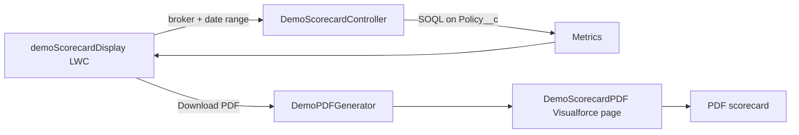

# Broker Scorecard (Salesforce LWC + PDF)

A portfolio demo of a broker performance scorecard for a commercial insurance program. Pick a broker and a date range, and Salesforce calculates that broker's production and exports it as a PDF scorecard you can send to the broker.

All brokers, policies, and amounts in this repository are synthetic.

## What it calculates

For the selected broker and effective-date range:

| Metric | Definition |
|---|---|
| Total policies / total premium | Every policy submitted by the broker in the range |
| Written policies / written premium | Policies with status `Written` |
| Hit rate | Written policies ÷ total policies |
| Premium hit rate | Written premium ÷ total premium |
| Written premium by line | General Liability, Professional Liability, Inland Marine, Commercial Property |

## How it works



- **demoScorecardDisplay** (Lightning Web Component) loads the list of brokers, takes the date range, shows the results, and requests the PDF.
- **DemoScorecardController** queries the broker's policies in the range and computes the metrics.
- **DemoPDFGenerator** renders the **DemoScorecardPDF** Visualforce page as a PDF.
- **DemoScorecardMetrics** exposes the same calculation as an invocable action, so a Flow can produce scorecards without the component (for example, a scheduled monthly run).

## Data model

`Policy__c` with lookups to the insured (`Account__c`) and the broker (`Broker__c`, an Account), plus `Premium__c`, `Status__c`, `Coverage_Type__c`, `Effective_Date__c`, and `Expiration_Date__c`.

## Try it

```bash
sf project deploy start --source-dir force-app
sf org assign permset --name Demo_Scorecard_Access
```

Create a few broker Accounts and `Policy__c` records with a mix of statuses and coverage types, then open the **Demo Scorecard** tab.

Test classes are included for the controller, the metrics action, and the PDF generator.
